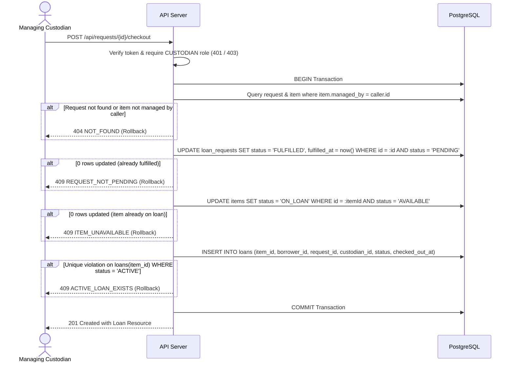

# Feature Contract F-05: Checkout

**Product:** Equipment Inventory and Borrowing System (Theme 2), CPE 334, Semester 1/2026  
**Related Issue:** #8  
**Feature:** F-05 Checkout  
**Requirements:** FR-09, BR-01, BR-02 (checkout side), BR-03 (checkout part), BR-05, BR-07 (supports NFR-01, NFR-05, NFR-07, NFR-08)  
**Decisions:** D-01, D-02, D-03, D-04, D-06, D-07, D-15  
**Version:** 1.0 (written before implementation)  
**Last updated:** 2026-11-05  
**Author:** Léo (Student B, ID 69540460045)  

The detailed design is in `docs/system-sds.md` (sections 5.2, 5.3, 6.1, 8.2, 8.3, 10.3 and 11). This contract defines the observable behavior, API specifications, acceptance criteria (AC-37 to AC-46), and the software test specification (TEST-58 to TEST-73) for F-05, including the required concurrency test.

---

## 1. Objective and scope

Feature F-05 enables the custodian managing an equipment item to fulfill a `PENDING` borrow request by executing an atomic checkout. The checkout creates an `ACTIVE` loan, marks the request `FULFILLED`, and sets the item `ON_LOAN`. It strictly enforces custodian ownership, protects against conflicting states, and guarantees concurrency safety through conditional updates and a partial unique database index.

| In scope | Out of scope |
|---|---|
| Atomic checkout transaction in PostgreSQL (FR-09) | Recording an item return (F-07, Sprint 2) |
| Managing custodian authorization and 404 scope isolation (BR-03) | Specifying loan return due dates (FR-13, Sprint 2) |
| Rejection of checkout for unavailable item (409 `ITEM_UNAVAILABLE`) (BR-02) | Handling overdue loan statuses (FR-14, Sprint 2) |
| Rejection of duplicate checkout of fulfilled request (409 `REQUEST_NOT_PENDING`) (BR-07) | Checkout starting from `APPROVED` request (BR-13, Sprint 2) |
| Guarantee of at most one active loan per item (BR-01, BR-05) | Direct checkout without prior request (forbidden by D-06) |
| Concurrent checkout protection via row-locks & partial index (BR-05) | Equipment barcode/QR code physical scanning |
| Copying `item_id` and `borrower_id` from request to loan | Borrower self-checkout |

Dependencies: F-03 (Catalog items) and F-04 (Borrow requests) provide the domain entities for checkout. F-06 (Consultation) displays the resulting loans and fulfilled requests.

---

## 2. Workflow



### Detailed steps:
1. The custodian clicks "Check out" on `/manage/requests` or calls `POST /api/requests/{id}/checkout`.
2. The route middleware verifies authentication (401) and checks role `CUSTODIAN` (403 for borrowers).
3. The route layer validates that `{id}` is a valid UUID (422 `VALIDATION_ERROR`).
4. The service begins an interactive database transaction (`prisma.$transaction`):
   - **Scope verification:** Loads the request joined with its item. If the request does not exist or `item.managed_by !== caller.id`, the transaction rolls back and returns 404 `NOT_FOUND` (BR-03, D-07: never reveals records outside the custodian's scope).
   - **Request transition:** Executes a conditional update: `UPDATE loan_requests SET status = 'FULFILLED', fulfilled_at = now() WHERE id = :id AND status = 'PENDING'`. If rows affected is 0, rolls back and returns 409 `REQUEST_NOT_PENDING` (BR-07).
   - **Item transition:** Executes a conditional update: `UPDATE items SET status = 'ON_LOAN' WHERE id = :itemId AND status = 'AVAILABLE'`. If rows affected is 0, rolls back and returns 409 `ITEM_UNAVAILABLE` (BR-02).
   - **Loan creation:** Inserts a new record into `loans`:
     - `item_id`: copied directly from the request.
     - `borrower_id`: copied directly from the request.
     - `request_id`: request ID.
     - `custodian_id`: caller's user ID.
     - `status`: `ACTIVE`.
     - `checked_out_at`: current UTC timestamp.
   - If a duplicate active loan constraint violation occurs (Prisma `P2002`), rolls back and returns 409 `ACTIVE_LOAN_EXISTS`.
5. The transaction commits and the API returns 201 Created with the loan object.
6. **Other pending requests:** Under assumption A-08 (Q-03), if other borrowers submitted pending requests for the same item, those requests remain in `PENDING` status. They cannot be checked out while the item is `ON_LOAN`.

---

## 3. Business rules, validation and boundaries

| Rule | Detail |
|---|---|
| Single active loan (BR-01, D-04) | An equipment item can have at most one loan with status `ACTIVE`. Enforced by partial unique index on `loans(item_id) WHERE status = 'ACTIVE'`. |
| Available item required (BR-02) | Checkout is permitted only if the item is currently `AVAILABLE`. If `ON_LOAN`, returns 409 `ITEM_UNAVAILABLE`. |
| Managing custodian scope (BR-03, D-03) | Only the custodian assigned to the item (`managed_by = caller.id`) can perform checkout. Any attempt by another custodian returns 404 `NOT_FOUND`. |
| Role restriction (BR-03) | Borrowers cannot perform checkout under any circumstances (403 `FORBIDDEN_ROLE`). |
| One checkout per request (BR-07) | A request can be checked out only once. Attempting to check out an already fulfilled request returns 409 `REQUEST_NOT_PENDING`. Enforced by conditional update and `UNIQUE(request_id)`. |
| Concurrency safety (BR-05) | When two concurrent checkouts target the same item (different requests or duplicate requests), exactly one transaction succeeds (201) and the other fails (409). No inconsistent database state or orphaned loans can occur. |
| Prior request mandatory (D-06) | Every loan must reference an existing fulfilled request (`request_id`). Direct loan creation without a request is not supported. |
| Field copying | `item_id` and `borrower_id` are copied from the request to prevent client manipulation. `custodian_id` is set to the authenticated caller. |

---

## 4. Data

F-05 updates `loan_requests` and `items`, and inserts into `loans`.

### `loans` schema summary
- `id`: UUID, primary key, default `gen_random_uuid()`.
- `item_id`: UUID, NOT NULL, FK → `items(id)` ON DELETE RESTRICT.
- `borrower_id`: UUID, NOT NULL, FK → `users(id)` ON DELETE RESTRICT.
- `request_id`: UUID, NOT NULL, UNIQUE, FK → `loan_requests(id)` ON DELETE RESTRICT.
- `custodian_id`: UUID, NOT NULL, FK → `users(id)` ON DELETE RESTRICT.
- `status`: ENUM `LoanStatus` (`ACTIVE`), NOT NULL, default `ACTIVE`.
- `checked_out_at`: TIMESTAMPTZ, NOT NULL, default `now()`.

### Database constraints protecting checkout
1. **Partial unique index on active loans (BR-01, BR-05):**
   ```sql
   CREATE UNIQUE INDEX idx_loans_active_item_unique 
   ON loans(item_id) 
   WHERE status = 'ACTIVE';
   ```
2. **Unique constraint on request (BR-07):**
   `UNIQUE(request_id)` on table `loans`.

---

## 5. API

All error responses strictly follow the uniform error format: `{ "error": { "code": "...", "message": "..." } }`.

### 5.1 POST /api/requests/{id}/checkout

Checks out a pending borrow request.

**Headers:** `Authorization: Bearer <token>` (Required, Custodian role)  
**URL parameter:** `id` (UUID of the loan request)  
**Request body:** None (empty)

| Outcome | Status | Code | Message / Body |
|---|---|---|---|
| Success | 201 | - | `{ "id": "<uuid>", "itemId": "<uuid>", "borrowerId": "<uuid>", "requestId": "<uuid>", "custodianId": "<uuid>", "status": "ACTIVE", "checkedOutAt": "<ISO-8601>" }` |
| Missing/invalid token | 401 | `UNAUTHENTICATED` | "Authentication required" |
| Caller is BORROWER | 403 | `FORBIDDEN_ROLE` | "Custodian role required" |
| Request not found or item not managed by caller | 404 | `NOT_FOUND` | "Request not found" |
| Request is not PENDING | 409 | `REQUEST_NOT_PENDING` | "This request is not pending" |
| Item is not AVAILABLE | 409 | `ITEM_UNAVAILABLE` | "This item is not available" |
| Active loan already exists for item | 409 | `ACTIVE_LOAN_EXISTS` | "An active loan already exists for this item" |
| Malformed `{id}` | 422 | `VALIDATION_ERROR` | Validation error with details array |

---

## 6. UI

| Screen | Behavior |
|---|---|
| Requests to process (`/manage/requests`) | Visible only to logged-in custodians. Displays a table of borrow requests for items managed by the logged-in custodian. Each pending request row features an active **Check out** button. |
| In-flight state | Clicking **Check out** displays a loading spinner and disables the button to prevent duplicate clicks (NFR-07). |
| Success feedback | On 201: request row updates or moves to processed; a success notification is shown; active loan is now visible in `/manage/loans`. |
| Error feedback | On 409 `REQUEST_NOT_PENDING`: banner displays "This request has already been processed". On 409 `ITEM_UNAVAILABLE`: banner displays "This item is currently unavailable". On 404: "Request not found". |

---

## 7. Permissions

| Operation | Anonymous | Borrower | Custodian | Scope / Notes |
|---|---|---|---|---|
| `POST /api/requests/{id}/checkout` | 401 | 403 | Allowed | Allowed only if `item.managed_by === caller.id` (404 otherwise) |

---

## 8. Acceptance criteria

| AC | Requirement | Expected observable outcome |
|---|---|---|
| **AC-37** | FR-09, BR-03 | A managing custodian calling `POST /api/requests/{id}/checkout` on a `PENDING` request for a managed `AVAILABLE` item receives 201 Created; an `ACTIVE` loan is created with `borrowerId` and `itemId` from the request, the request becomes `FULFILLED` (`fulfilledAt` set), and the item becomes `ON_LOAN`. |
| **AC-38** | BR-03 | A custodian calling checkout on a request for an item managed by a different custodian receives 404 `NOT_FOUND`, and no database change occurs. |
| **AC-39** | BR-03, NFR-01 | A borrower calling `POST /api/requests/{id}/checkout` receives 403 `FORBIDDEN_ROLE` and no database change occurs. |
| **AC-40** | BR-07 | Calling checkout on an already `FULFILLED` request returns 409 `REQUEST_NOT_PENDING` and alters no database records. |
| **AC-41** | BR-02 | Calling checkout on a `PENDING` request whose item has already become `ON_LOAN` returns 409 `ITEM_UNAVAILABLE` and rolls back the transaction. |
| **AC-42** | BR-01, BR-05 | When two concurrent checkout requests attempt to checkout requests for the same item, exactly one succeeds with 201 Created and the other fails with 409; exactly one `ACTIVE` loan exists for the item. |
| **AC-43** | BR-01 | Inserting a second `ACTIVE` loan for the same item directly via SQL/Prisma is rejected by the partial unique index on `loans(item_id) WHERE status = 'ACTIVE'`. |
| **AC-44** | BR-07 | Inserting a second loan referencing the same `request_id` directly in the database is rejected by the unique constraint on `loans(request_id)`. |
| **AC-45** | FR-09 | Calling checkout with a malformed `{id}` returns 422 `VALIDATION_ERROR`; calling with a non-existent UUID returns 404 `NOT_FOUND`. |
| **AC-46** | FR-09, NFR-07 | In the UI, a custodian can view pending requests for managed items on `/manage/requests`, click "Check out" with visual feedback, and see the request fulfilled and reflected in `/manage/loans`. |

---

## 9. Software Test Specification

| Test | AC | Level | Precondition / input | Action | Expected result |
|---|---|---|---|---|---|
| **TEST-58** | AC-37 | Integration (API + DB) | Seeded DB, `custodian1` logged in, item `EQ-002` (managed by `custodian1`) is `AVAILABLE`, `borrower1` has `PENDING` request `R1` on it | POST `/api/requests/{R1.id}/checkout` | 201 Created; loan returned with `status: "ACTIVE"`, `borrowerId: borrower1.id`, `itemId: EQ-002.id`, `custodianId: custodian1.id`; in DB request is `FULFILLED` with `fulfilled_at` set, item is `ON_LOAN` |
| **TEST-59** | AC-38 | Integration (API + DB) | Item `EQ-005` is managed by `custodian2`, `borrower1` has `PENDING` request `R2` on it; `custodian1` logged in | `custodian1` calls POST `/api/requests/{R2.id}/checkout` | 404 `NOT_FOUND`; `R2` status remains `PENDING`, item `EQ-005` remains `AVAILABLE`, no loan created |
| **TEST-60** | AC-39 | Integration (API) | `borrower1` logged in, valid request `R1` exists | `borrower1` calls POST `/api/requests/{R1.id}/checkout` | 403 `FORBIDDEN_ROLE`; no changes |
| **TEST-61** | AC-39, NFR-01 | Integration (API) | No token, valid request `R1` exists | POST `/api/requests/{R1.id}/checkout` | 401 `UNAUTHENTICATED` |
| **TEST-62** | AC-40 | Integration (API + DB) | Request `R_seed` on item `EQ-001` is already `FULFILLED` | Managing custodian calls POST `/api/requests/{R_seed.id}/checkout` | 409 `REQUEST_NOT_PENDING`; no second loan created |
| **TEST-63** | AC-41 | Integration (API + DB) | Item `EQ-002` manually set to `ON_LOAN`, pending request `R1` exists | Managing custodian calls POST checkout on `R1` | 409 `ITEM_UNAVAILABLE`; `R1` remains `PENDING`, transaction rolls back |
| **TEST-64** | AC-43 | Integration (DB) | Loan `L1` exists with `item_id = EQ-001.id`, `status = 'ACTIVE'` | Direct SQL/Prisma INSERT of another loan `L2` with `item_id = EQ-001.id`, `status = 'ACTIVE'` | Database throws unique constraint violation on partial index |
| **TEST-65** | AC-44 | Integration (DB) | Loan `L1` exists referencing `request_id = R1.id` | Direct INSERT of another loan referencing `request_id = R1.id` | Database throws unique constraint violation on `loans_request_id_key` |
| **TEST-66** | AC-45 | Integration (API), boundary | Managing custodian logged in | POST `/api/requests/not-a-valid-uuid/checkout` | 422 `VALIDATION_ERROR` |
| **TEST-67** | AC-45 | Integration (API) | Managing custodian logged in | POST `/api/requests/<random-uuid>/checkout` | 404 `NOT_FOUND` |
| **TEST-68** | AC-42 | Integration (Concurrency) | Item `EQ-003` is `AVAILABLE`; `borrower1` and `borrower2` both have `PENDING` requests `R_A` and `R_B` for `EQ-003` | Execute `POST /api/requests/{R_A.id}/checkout` and `POST /api/requests/{R_B.id}/checkout` concurrently via `Promise.all` | Exactly one call returns 201 Created and the other returns 409 (either `ITEM_UNAVAILABLE` or `ACTIVE_LOAN_EXISTS`); exactly one `ACTIVE` loan exists for `EQ-003`; item status is `ON_LOAN` |
| **TEST-69** | AC-42 | Integration (Concurrency) | Single pending request `R1` on available item `EQ-002` | Execute two identical checkout requests `POST /api/requests/{R1.id}/checkout` concurrently via `Promise.all` | Exactly one returns 201 Created, the other returns 409 (`REQUEST_NOT_PENDING`); exactly one loan created |
| **TEST-70** | AC-37 | Unit | Checkout service | Mock failed item update (0 rows affected) | Transaction rolls back, service throws typed error mapping to 409 `ITEM_UNAVAILABLE` |
| **TEST-71** | AC-37 | Unit | Checkout service | Mock failed request update (0 rows affected) | Transaction rolls back, service throws typed error mapping to 409 `REQUEST_NOT_PENDING` |
| **TEST-72** | AC-37 | Unit | Checkout service | Mock Prisma `P2002` on loan insertion | Transaction rolls back, service throws typed error mapping to 409 `ACTIVE_LOAN_EXISTS` |
| **TEST-73** | AC-46 | E2E (Playwright) | Seeded database with pending request on managed item | Custodian logs in, navigates to `/manage/requests`, clicks "Check out", verifies row is removed and appears in `/manage/loans`; borrower logs in and verifies loan appears in `/my` | Custodian successfully performs checkout with live UI updates; borrower sees loan active |

Every AC is covered by at least one test.  
Negative test cases: TEST-59, TEST-60, TEST-61, TEST-62, TEST-63, TEST-64, TEST-65, TEST-66, TEST-67.  
Boundary test cases: TEST-66, TEST-67.  
Concurrency test cases: TEST-68, TEST-69.  
Unit transaction test cases: TEST-70, TEST-71, TEST-72.

---

## 10. Definition of Done for F-05

- [ ] All behaviors of sections 2 to 7 implemented.
- [ ] TEST-58 to TEST-73 written before implementation, observed failing (red), then passing (green). Real counts reported.
- [ ] Checkout transaction implemented with conditional updates inside `prisma.$transaction`.
- [ ] Concurrency test (TEST-68) executes against real PostgreSQL database and passes consistently.
- [ ] Partial unique index on `loans(item_id) WHERE status = 'ACTIVE'` created and verified by TEST-64.
- [ ] PR reviewed by teammate (Baptiste) with specific feedback, then merged into `sprint-1-staging`.
- [ ] No secrets in Git or `.env.example`.
- [ ] Incomplete work disclosed in the PR.

---

## 11. Assumptions and open points

- In Sprint 1, checkout transitions directly from `PENDING` to `FULFILLED` and creates an `ACTIVE` loan. In Sprint 2, checkout will require an `APPROVED` request (D-15, BR-13).
- When an item is checked out, other existing pending requests for that item remain in `PENDING` status (Assumption A-08, Q-03).
- Return processing is deferred to Sprint 2 (F-07, BR-09).

---

## 12. Version history

| Version | Date | Change | Author |
|---|---|---|---|
| 1.0 | 2026-11-05 | Initial feature contract for F-05 before implementation | Léo (Student B) |
