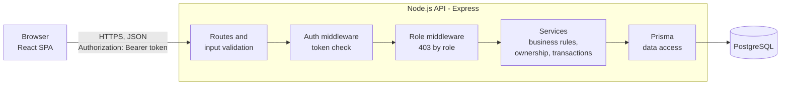
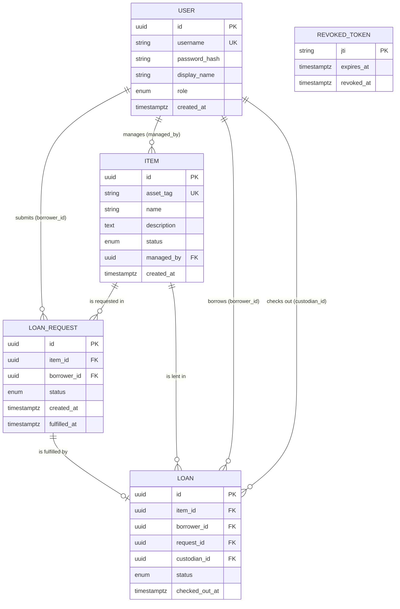
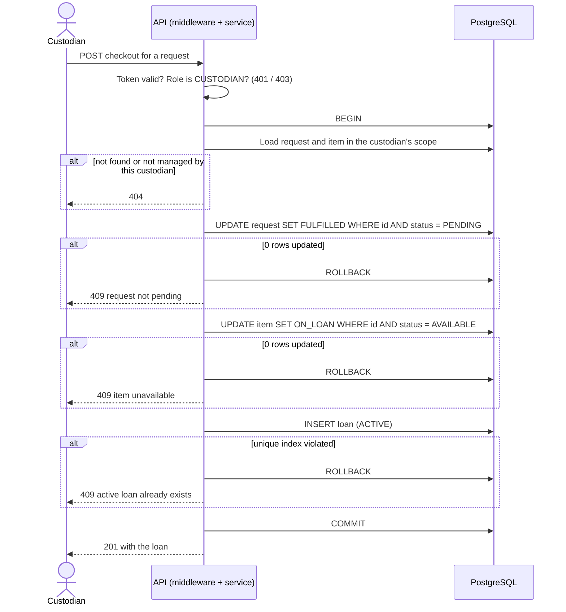

# System-Level Software Design Specification (SDS)

**Product:** Equipment Inventory and Borrowing System (Theme 2)
**Course:** CPE 334, Semester 1/2026
**Team:** DUBROEUCQ Baptiste [69540460002] and LEPOUTRE Léo [69540460045]
**Repository:** https://github.com/Bptdbr/cpe334-inventory-borrowing
**Related Issues:** #4 (sections 1 to 7), #5 (sections 8 to 12)
**Version:** 0.1 (architecture and data, draft for PR review)
**Last updated:** 03/11/2026

> **Document status.** Sections 1 to 7 (architecture, stack, repository structure, data model, rule enforcement, database setup and seed) are written in Issue #4. Sections 8 to 12 (role/permission matrix, authentication lifecycle, API and UI conventions, configuration, deployment plan) are written in Issue #5 and are listed here only as headings so that both Issues can be merged without conflicts.

---

## 1. Introduction

### 1.1 Purpose

This document defines the shared technical decisions that apply across the whole application: architecture, technology stack, major components, data model and database setup. Feature-level designs (detailed endpoints, screens, test cases) are written later in the feature engineering contracts under `docs/sprints/`.

### 1.2 Inputs

- `docs/srs.md` version 1.1 (requirements FR-01 to FR-21, BR-01 to BR-13, NFR-01 to NFR-11).
- `docs/decisions.md` version 1.1 (decisions D-01 to D-18; D-14 to D-18 are listed in section 1.3).

### 1.3 Design decisions taken for this document

These decisions are also recorded in `docs/decisions.md`. D-17 and D-18 are marked `To confirm` there until the review of this document.

| ID | Decision | Rationale |
|---|---|---|
| D-14 | Authentication uses a **signed token** (JWT) sent in the `Authorization: Bearer` header. Token lifetime: 60 minutes (NFR-06). | Stateless API, easy to test, suitable for containers. Resolves Q-02. |
| D-15 | **Approval of requests is introduced in Sprint 2.** Sprint 1 has no approval step. | The product baseline includes approval; Sprint 1 stays minimal. |
| D-16 | The `MAINTENANCE` item status (Sprint 2) and item categories (Sprint 3) are part of the product. | They remain in scope of the full product. |
| D-17 | Stack: TypeScript, Node.js, Express, React with Vite, PostgreSQL, Prisma. | Same family of tools as in Labs 1 to 4, one language across the stack. |
| D-18 | Logout is implemented by **revoking the token's identifier (`jti`)** in a `revoked_tokens` table until its natural expiry. | A signed token cannot be invalidated otherwise, and FR-02 requires logout to invalidate it. |

### 1.4 Scope of this document

| In this document | Elsewhere |
|---|---|
| Architecture, stack, structure, data model, enforcement of rules, database setup and seed | Role/permission matrix, authentication lifecycle, API and UI conventions, configuration, deployment plan: sections 8 to 12 (Issue #5) |
| | Detailed endpoints, screens and test cases: feature contracts (Issues #6 to #8) |

---

## 2. Architecture

### 2.1 Architectural style

A **modular monolith** with three logical layers: a single-page web application, a REST API with a service layer, and a relational database. The three layers do not require three servers: the API and the database are two processes (or containers), and the frontend is static files served separately or by the API.

### 2.2 Components and responsibilities

| Component | Responsibility | Does **not** do |
|---|---|---|
| **React SPA** (frontend) | Screens, navigation by role, client-side input hints, display of server errors, storing the token for the session | Enforce permissions or business rules (a hidden button is not authorization) |
| **API routes** | HTTP mapping, input validation (schemas), calling services, mapping errors to HTTP codes | Business rules |
| **Auth middleware** | Verify the token signature, expiry and revocation; attach the current user to the request | Decide domain access |
| **Role middleware** | Reject operations the user's role is not allowed to perform (403) | Check ownership of a specific record |
| **Services** (business layer) | Business rules, ownership and scope checks, transactions, state transitions | HTTP concerns |
| **Prisma data access** | Queries and transactions against PostgreSQL | Business decisions |
| **PostgreSQL** | Durable storage, referential integrity, last-line constraints (unique indexes, foreign keys, enums) | Role logic |

### 2.3 Component diagram



### 2.4 Backend modules

| Module | Sprint | Content |
|---|---|---|
| `auth` | 1 | Login, logout, current user, token creation and verification |
| `catalog` | 1 | List items, create item (edit, retire, search in later sprints) |
| `requests` | 1 | Create request, list own requests, list requests of managed items (cancel, approve, reject in Sprint 2) |
| `loans` | 1 | Checkout, list loans (return, due dates, overdue in Sprint 2) |
| `reports` | 3 | Inventory summary, overdue list |

Each module contains its routes, its service and its input schemas. Modules communicate through service functions, never through each other's database queries.

### 2.5 Where each category of rule is enforced

| Category | Enforced in | Why there |
|---|---|---|
| Authentication (valid token) | Auth middleware | Single entry point for all protected routes |
| Role permission (is this role allowed?) | Role middleware, declared per route | Visible and testable per endpoint |
| Ownership and scope (is this record mine or in my scope?) | Services, through the query filter | The decision depends on the record |
| State transitions and business rules | Services, inside a transaction | Rules must hold regardless of which client calls the API |
| Uniqueness and integrity (one active loan per item, etc.) | **Database constraints** | Last line of defense under concurrent requests |
| Input shape and types | Route validation (schemas) | Reject malformed input before any logic |

---

## 3. Technology stack

| Layer | Technology | Purpose | Alternative not chosen |
|---|---|---|---|
| Language | TypeScript (strict mode) | One typed language for frontend and backend | Plain JavaScript |
| Runtime | Node.js, current LTS version, pinned in `.nvmrc` and `engines` | Run the API | Other runtimes |
| API framework | Express | HTTP routing and middleware | Fastify, NestJS |
| Validation | Zod | Request schemas, typed inputs | Manual validation |
| ORM and migrations | Prisma and Prisma Migrate | Typed data access, versioned migrations | Raw SQL, TypeORM |
| Database | PostgreSQL 16 | Durable relational storage, partial unique indexes, row locking | MySQL (no partial indexes), SQLite (file lost on redeployment without a volume) |
| Authentication | Signed JWT (D-14) with revocation list (D-18); library and password-hashing algorithm are specified in section 8 | Stateless session | Server-side sessions |
| Frontend | React with Vite and React Router | Single-page application | Server-rendered pages |
| Unit and integration tests | Vitest, with Supertest for HTTP-level API tests | Rules, persistence, permissions | Jest |
| End-to-end tests | Playwright | Critical user journeys through the UI | Cypress |
| Package manager | npm, with a committed lock file | Reproducible installs | pnpm, yarn |

Exact dependency versions are fixed by the lock files and are not repeated in this document.

---

## 4. Repository structure

```
cpe334-inventory-borrowing/
├── backend/
│   ├── prisma/
│   │   ├── schema.prisma
│   │   ├── migrations/            # versioned SQL, including raw-SQL constraints
│   │   └── seed.ts                # demo data
│   ├── src/
│   │   ├── app.ts                 # Express app (importable by tests)
│   │   ├── server.ts              # process entry point
│   │   ├── config.ts              # reads environment variables
│   │   ├── middleware/            # authenticate, requireRole, errorHandler
│   │   ├── lib/                   # prisma client, error types, clock
│   │   └── modules/
│   │       ├── auth/
│   │       ├── catalog/
│   │       ├── requests/
│   │       └── loans/
│   └── tests/
│       ├── unit/
│       └── integration/
├── frontend/
│   ├── src/                       # pages, components, api client, auth context
│   └── e2e/                       # Playwright tests
├── docs/                          # srs, decisions, features, traceability,
│   └── sprints/                   # system-sds, sprint plan and contracts
├── .env.example
├── .gitignore
└── README.md
```

The Express `app` is exported separately from the code that starts the server, so integration tests can call the API without opening a network port.

---

## 5. Data model

### 5.1 Entities and relationships



### 5.2 Tables (Sprint 1)

All identifiers are UUIDs. All timestamps are `timestamptz` and are stored in UTC.

**`users`**

| Column | Type | Constraints |
|---|---|---|
| id | uuid | PK |
| username | varchar(50) | NOT NULL, UNIQUE |
| password_hash | varchar | NOT NULL (hash only, never the password) |
| display_name | varchar(100) | NOT NULL |
| role | enum `Role` (`BORROWER`, `CUSTODIAN`) | NOT NULL |
| created_at | timestamptz | NOT NULL, default now |

**`items`**

| Column | Type | Constraints |
|---|---|---|
| id | uuid | PK |
| asset_tag | varchar(30) | NOT NULL, UNIQUE |
| name | varchar(100) | NOT NULL |
| description | text | NOT NULL, default empty string |
| status | enum `ItemStatus` (`AVAILABLE`, `ON_LOAN`) | NOT NULL, default `AVAILABLE` |
| managed_by | uuid | NOT NULL, FK → `users.id`, ON DELETE RESTRICT |
| created_at | timestamptz | NOT NULL, default now |

**`loan_requests`**

| Column | Type | Constraints |
|---|---|---|
| id | uuid | PK |
| item_id | uuid | NOT NULL, FK → `items.id`, ON DELETE RESTRICT |
| borrower_id | uuid | NOT NULL, FK → `users.id`, ON DELETE RESTRICT |
| status | enum `RequestStatus` (`PENDING`, `FULFILLED`) | NOT NULL, default `PENDING` |
| created_at | timestamptz | NOT NULL, default now |
| fulfilled_at | timestamptz | NULL until fulfilled |

**`loans`**

| Column | Type | Constraints |
|---|---|---|
| id | uuid | PK |
| item_id | uuid | NOT NULL, FK → `items.id`, ON DELETE RESTRICT |
| borrower_id | uuid | NOT NULL, FK → `users.id`, ON DELETE RESTRICT |
| request_id | uuid | NOT NULL, UNIQUE, FK → `loan_requests.id` (one loan per request) |
| custodian_id | uuid | NOT NULL, FK → `users.id`, ON DELETE RESTRICT |
| status | enum `LoanStatus` (`ACTIVE`) | NOT NULL, default `ACTIVE` |
| checked_out_at | timestamptz | NOT NULL, default now |

**`revoked_tokens`** (D-18)

| Column | Type | Constraints |
|---|---|---|
| jti | varchar | PK (the token's unique identifier) |
| expires_at | timestamptz | NOT NULL, indexed (expired rows can be deleted) |
| revoked_at | timestamptz | NOT NULL, default now |

### 5.3 Constraints that protect the business rules

| Constraint | Definition | Protects |
|---|---|---|
| One active loan per item | **Partial unique index** on `loans(item_id)` where `status = 'ACTIVE'` | BR-01, BR-05 |
| One pending request per borrower and item | **Partial unique index** on `loan_requests(item_id, borrower_id)` where `status = 'PENDING'` | BR-06 |
| One loan per request | UNIQUE on `loans(request_id)` | BR-07 |
| Unique login and asset tag | UNIQUE on `users(username)` and `items(asset_tag)` | Identification |
| Valid statuses and roles | PostgreSQL enum types | Invalid states cannot be stored |
| Referential integrity | Foreign keys with ON DELETE RESTRICT | No orphan records |

**Prisma limitation.** Prisma's schema language cannot express partial unique indexes. They are created by hand-written SQL inside a migration (created with `prisma migrate dev --create-only`, then the SQL is edited). Consequences for the team:

- Use `prisma migrate` only. Do **not** use `prisma db push`, which compares the database to `schema.prisma` and may drop indexes it does not know.
- The raw SQL migration is committed and reviewed like any other code.
- A test verifies that the partial indexes exist and reject a second active loan inserted directly in the database.

### 5.4 Ownership and visibility at data level

| Link | Meaning | Used for |
|---|---|---|
| `items.managed_by` → custodian | The managing custodian of an item | BR-03, BR-08: scope of a custodian |
| `loan_requests.borrower_id` | Owner of a request | BR-04: borrower sees only their own |
| `loans.borrower_id` | Owner of a loan | BR-04 |
| `loans.custodian_id` | Custodian who performed the checkout (audit) | History |

Services never fetch a record by id alone. Every query includes the scope of the current user:

- Borrower: `where borrower_id = currentUser.id`.
- Custodian: `where item.managed_by = currentUser.id`.

A record outside the scope is reported as **404** (D-07), so a user cannot learn whether another user's record exists. A malformed identifier is rejected with 422.

The rule that `items.managed_by` must reference a user with role `CUSTODIAN` cannot be expressed as a simple foreign key. It is enforced in the catalog service when an item is created, and by the seed script.

### 5.5 Planned evolution (Sprints 2 and 3)

The model grows by additive migrations; no Sprint 1 table is redesigned.

| Sprint | Change | Requirement |
|---|---|---|
| 2 | `items.status` gains `MAINTENANCE` and `RETIRED` | FR-11, D-16 |
| 2 | `loan_requests.status` gains `APPROVED`, `REJECTED`, `CANCELLED`. Checkout then starts from an `APPROVED` request instead of a `PENDING` one | D-15, FR-12 |
| 2 | `loans` gains `due_at` and `returned_at`; `loans.status` gains `RETURNED` and `OVERDUE` (or overdue is derived from `due_at`) | FR-10, FR-13, FR-14 |
| 3 | `items` gains `category` | D-16, FR-15 |
| 3 | Indexes for search and reporting queries | FR-15, FR-16, NFR-09 |

The Sprint 2 approval step changes the precondition of the checkout rule (BR-07). This is handled as a visible contract revision in Sprint 2, not as a silent rewrite.

---

## 6. Business-rule enforcement map

Test IDs are assigned in the feature contracts (Issues #6 to #8). The test level is fixed here.

| Rule | Application layer | Database safeguard | Test level |
|---|---|---|---|
| BR-01 One active loan per item | Checkout service | Partial unique index on active loans | Integration (API + database) |
| BR-02 Only an `AVAILABLE` item can be requested or checked out | Request and checkout services | (none) | Integration |
| BR-03 Only the managing custodian can check out and see managed requests and loans | Role middleware and service scope filter | (none) | Integration (role and ownership) |
| BR-04 A borrower only sees and acts on their own records | Service scope filter (404 otherwise) | (none) | Integration |
| BR-05 Concurrent checkouts produce exactly one active loan | Conditional update inside a transaction | Partial unique index on active loans | Concurrency integration test |
| BR-06 No second pending request for the same item by the same borrower | Request service pre-check | Partial unique index on pending requests | Integration |
| BR-07 A request can be checked out only once, from `PENDING` | Conditional update of the request status | UNIQUE on `loans(request_id)` | Integration |
| BR-08 A custodian only adds items they manage | Catalog service sets `managed_by` from the token | Foreign key | Integration |
| BR-09 to BR-12 | Designed in Sprint 2 contracts | | |

### 6.1 Checkout transaction (F-05)

The checkout is the central transition of the product. It runs in a single database transaction and relies on **conditional updates**: the status change itself is the check, so two concurrent requests cannot both pass it.



Why this is concurrency-safe: when two checkouts target the same item, the second conditional update waits for the first transaction's row lock, then finds the status already `ON_LOAN`, updates zero rows, and rolls back with 409. If both somehow reached the insert, the partial unique index rejects the second loan. The API maps a unique-violation error from Prisma (code `P2002`) to 409.

### 6.2 Request creation (F-04)

The request service checks that the item exists, is `AVAILABLE` (409 otherwise), then inserts a `PENDING` request. The partial unique index rejects a second pending request from the same borrower for the same item (409).

---

## 7. Database setup, migrations and seed

### 7.1 Environments

| Database | Purpose |
|---|---|
| `inventory_dev` | Local development and demonstration |
| `inventory_test` | Automated tests, emptied and re-seeded before each integration test run |

PostgreSQL runs locally or in a container started for development. The connection is given only through the `DATABASE_URL` environment variable (documented in `.env.example`).

### 7.2 Commands (documented in the README)

| Command | Effect |
|---|---|
| `npm run db:migrate` | Apply pending migrations (`prisma migrate deploy` in non-development environments) |
| `npm run db:seed` | Insert demo data (idempotent) |
| `npm run db:reset` | Drop, recreate, migrate and seed the development database |
| `npm test` | Run unit and integration tests against `inventory_test` |

### 7.3 Seed content (synthetic data only)

| Data | Content |
|---|---|
| Users | 2 borrowers and 2 custodians with synthetic names. All share one demo password read from the `SEED_DEMO_PASSWORD` environment variable and are stored hashed |
| Items | 8 items with unique asset tags, split between the two custodians (4 each) |
| State | 1 item already `ON_LOAN`, with a `FULFILLED` request and an `ACTIVE` loan, so a rejection can be demonstrated without preparation |

Seed properties:

- **Repeatable:** items and users are upserted by `asset_tag` and `username`; running the seed twice creates no duplicates.
- **No secrets in Git:** `.env.example` contains only a dummy value; the real demo password is shared privately.
- **Reproducible demo:** `npm run db:reset` returns the database to the same known state.

### 7.4 Persistence

All domain data lives in PostgreSQL. The API keeps no domain state in memory, so data survives an API restart (NFR-03), and the same design works when PostgreSQL uses a persistent volume or a managed instance in Lab 5.

---

## 8. Role and permission matrix

*To be written in Issue #5.*

## 9. Authentication and token lifecycle

*To be written in Issue #5.* The decisions already fixed here are D-14 (signed token, 60 minutes) and D-18 (logout by revocation of the token identifier).

## 10. API conventions and error handling

*To be written in Issue #5.* The status-code rule already fixed in D-07 is: 401 unauthenticated, 403 role not allowed, 404 outside the user's scope, 409 state conflict, 422 invalid input.

## 11. UI conventions

*To be written in Issue #5.*

## 12. Configuration and deployment plan

*To be written in Issue #5.*

---

## Change history

| Version | Date | Change | Author |
|---|---|---|---|
| 0.1 | 03/11/2026 | Sections 1 to 7: architecture, stack, structure, data model, rule enforcement, database setup and seed | Léo |
